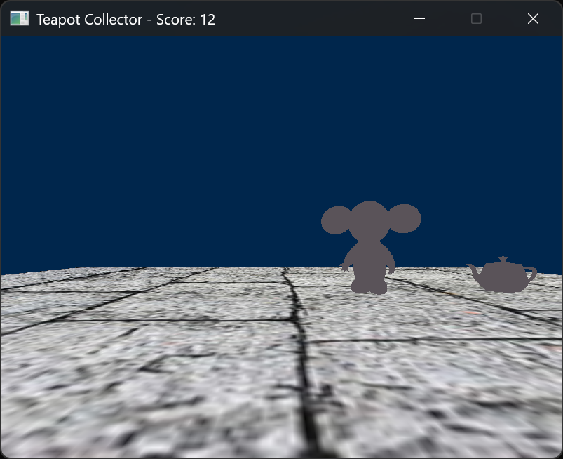

# Teapot Collector
- This is basically a 3D game using OpenGL, it is about a monkey collecting as much teapots as possible with weird turning.
# Features
## Renderer
- Rendering .obj files with objmodel
- Shaders loading
- Transforms with x, y, and z
- Image textures
- Indexed Mesh system
- Camera system with x, y, and z
## Game
- Random location for teapot
- Scores with collision detection
- Movement system with SDL's input system

# How do I play this?
Go to release page then download and extract the release zip. Controls are in CONTROLS.txt!

# Showcase

# Credits:
- Alec Jacobson for obj models
- Sean Barrett for stb_image
- Benny for obj_loader
